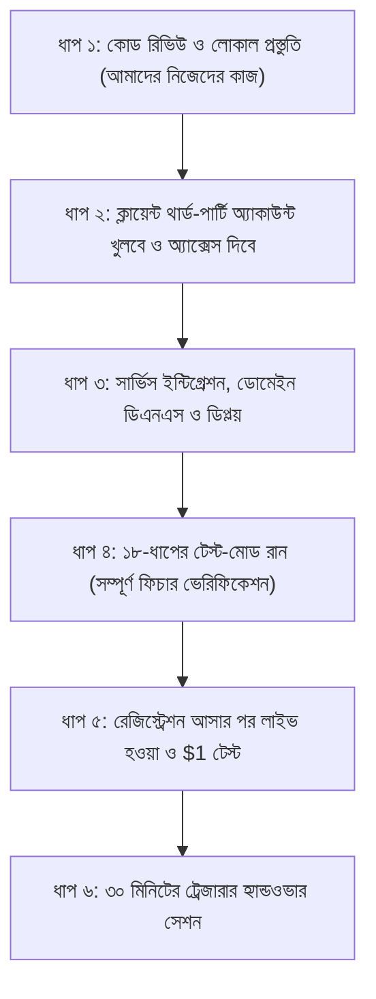

# Project Execution Roadmap (Step-by-Step Action Plan)
**Project:** Prospect Road Community Fund Website  
**Version:** 1.0  
**Updated:** October 2026  
**Reference Documents:** [docs/CLIENT_REQUIREMENTS.md](file:///c:/Users/Nirob/project/community-fund-website/docs/CLIENT_REQUIREMENTS.md) · [docs/LAUNCH_CHECKLIST.md](file:///c:/Users/Nirob/project/community-fund-website/docs/LAUNCH_CHECKLIST.md) · [docs/HANDOVER.md](file:///c:/Users/Nirob/project/community-fund-website/docs/HANDOVER.md)

---

## কাজের পর্যায়ক্রমিক ফ্লোচার্ট (Execution Flow)



---

## 🟢 ধাপ ১: কোড রিভিউ ও লোকাল প্রস্তুতি (Immediate Actions — আপনার কাজ)
*ক্লায়েন্টের কাছে যাওয়ার আগেই নিশ্চিত হওয়া যে বর্তমান কোডে কোনো সমস্যা নেই।*

- [x] **লোকাল কোড ও সিকিউরিটি চেক রান করা:** (Passed 100%: Check, 96 Unit Tests, 52 DB Tests)
  ```powershell
  npm run check
  npm run test:unit
  npm run test:db
  ```
- [x] **ফিক্সগুলো রিভিউ করা:**
  - **Neighborhood Grouping:** এলাকাভিত্তিক গ্রুপিং ও চার্ট ভেরিফাইড (ডিফল্ট তালিকা নিশ্চিত)।
  - **Server-side Validation:** `pledge.mjs` এবং `giving.mjs`-এ সার্ভার-সাইড লিমিট ও স্যানিটাইজেশন ভেরিফাইড।
  - **Audit Log Protection:** ডেটাবেজের অডিট লগ ও অ্যাক্টিভিটি লগে কোনো এডিট/ডিলিট পারমিশন নেই (Triggers ও RLS ভেরিফাইড)।

---

## 🟡 ধাপ ২: ক্লায়েন্টের থার্ড-পার্টি অ্যাকাউন্ট সেটআপ (Client Coordination)
*ক্লায়েন্ট ফান্ডের অফিসিয়াল ইমেইল দিয়ে মূল অ্যাকাউন্টগুলোর মালিকানা (Owner) নিবে।*

- [x] **অ্যাকাউন্টগুলো সেটআপ সম্পন্ন (বর্তমান টেস্ট ও ডিপ্লয়মেন্টের জন্য):**
  - **Supabase:** ডেটাবেজ প্রজেক্ট তৈরি ও সম্পূর্ণ স্কিমা চালু।
  - **Stripe:** টেস্ট অ্যাকাউন্ট ও কী কানেক্টেড।
  - **Resend:** ট্রানজ্যাকশনাল ইমেইলের জন্য Resend API ও SMTP কনফিগার করা।
  - **Cloudflare & Netlify:** ক্লাউডফ্লেয়ার টার্নস্টাইল এবং নেটলিফাই হোস্টিং কানেক্টেড।
- [x] **ট্রেজারার অ্যাক্সেস প্রদান:**
  - `nirobhossainalip@gmail.com` একাউন্টে ট্রেজারার হিসেবে সম্পূর্ণ অ্যাক্সেস কনফার্ম করা হয়েছে।

---

## 🔵 ধাপ ৩: সার্ভিস ইন্টিগ্রেশন ও লাইভ ডিপ্লয় (Integration & Deploy)
*কোড ও ক্লাউড সার্ভিসগুলো একসাথে যুক্ত করে সাইট অনলাইনে তোলা।*

- [x] **Netlify-তে সাইট কানেক্ট ও ডিপ্লয়:**
  - রিপোজিটরি Netlify-তে ডিপ্লয় করা এবং `.env`-এর লাইভ ভেরিয়েবল সেট করা।
  - লাইভ সাইট: `https://prospectroadfund.netlify.app/`
- [x] **পোস্ট-ডিপ্লয় ভেরিফিকেশন:**
  - ডিপ্লয় শেষে লাইভ সাইটের সিকিউরিটি টেস্ট চালানো:
    ```powershell
    npm run verify -- https://prospectroadfund.netlify.app
    ```
  - রেজাল্ট: **`18 passed, 0 failed`**।

---

## 🟣 ধাপ ৪: ১৮-ধাপের টেস্ট মোড রান (Full 18-Step Test-Mode Verification)
*কোনো আসল টাকা স্পর্শ না করে Stripe Test Card দিয়ে সম্পূর্ণ সিস্টেমের মহড়া চালানো।*

[docs/LAUNCH_CHECKLIST.md](file:///c:/Users/Nirob/project/community-fund-website/docs/LAUNCH_CHECKLIST.md) ফাইল দেখে ১৮টি ধাপ একে একে টেস্ট করা:
1. [ ] ট্রেজারার, রেকর্ডার ও অডিটরের ওটিপি সাইন-ইন চেক।
2. [ ] হোমপেজ থেকে $100 প্লেজ জমা দিয়ে Stripe টেস্ট কার্ড (`4242 4242...`) দিয়ে পেমেন্ট সফল করা।
3. [ ] পেমেন্টের বিপরীতে রসিদ তৈরি হওয়া এবং Stripe-এর ফি খরচের তালিকায় যোগ হওয়া।
4. [ ] অ্যাডমিন প্যানেল থেকে কার্ড রিফান্ড ইস্যু করে দেখা।
5. [ ] অফলাইনে ক্যাশ/চেকের টাকা ও খরচের ভাউচার এন্ট্রি করা।
6. [ ] ৮টি সিএসভি (CSV) ফাইল ডাউনলোড করে ডেটা ঠিক আছে কিনা দেখা।
7. [ ] ফান্ড ক্লোজিং এবং আনুপাতিক রিফান্ড ক্যালকুলেশন সঠিক সেন্ট পর্যন্ত মিলছে কিনা যাচাই করা।

---

## 🔴 ধাপ ৫: লাইভ হওয়া (Going Live — রেজিস্ট্রেশন আসার পর)
*ফ্লোরিডার চ্যারিটি রেজিস্ট্রেশন (FDACS) নম্বর হাতে পাওয়ার পর এই ধাপটি করা হবে।*

- [ ] **অ্যাডমিন প্যানেলে রেজিস্ট্রেশন নম্বর যুক্ত করা:**
  - `/admin/` > Settings-এ গিয়ে FDACS নম্বর বসানো এবং **"Open online card payments"** চালু করা।
- [ ] **Stripe লাইভ মোডে নেওয়া:**
  - Netlify-তে Stripe-এর লাইভ সিক্রেট কী (`sk_live_...`) এবং লাইভ Webhook Secret বসানো।
- [ ] **$1 রিয়েল পেমেন্ট ও রিফান্ড টেস্ট:**
  - একটি আসল ক্রেডিট কার্ড দিয়ে সাইটে **১ ডলার ($1)** ডোনেট করা।
  - পেমেন্ট সফল হওয়ার সাথে সাথে অ্যাডমিন প্যানেল থেকে সেই $1 কার্ডে রিফান্ড করে দেওয়া। (এর মাধ্যমে নিশ্চিত হওয়া যে লাইভ পেমেন্ট ও রিফান্ড ১০০% কার্যকর)।

---

## 🏁 ধাপ ৬: ট্রেজারার হ্যান্ডওভার সেশন (Final Handover)
*প্রজেক্ট ক্লায়েন্টের কাছে চূড়ান্তভাবে হস্তান্তর করা।*

- [ ] **৩০ মিনিটের ট্রেনিং সেশন:** 
  - জুম বা গুগল মিটে ফান্ডের ট্রেজারারকে স্ক্রিন শেয়ার করে দেখানো কীভাবে লগইন করতে হবে, অফলাইন টাকা এন্ট্রি দিতে হবে এবং হিসাব ডাউনলোড করতে হবে।
- [ ] **সিকিউরিটি লকডাউন ও কী রোটেশন ([docs/HANDOVER.md](file:///c:/Users/Nirob/project/community-fund-website/docs/HANDOVER.md)):**
  - ক্লায়েন্ট ডেভেলপারকে সব সার্ভিস (Netlify, Supabase, Stripe, Resend) থেকে রিমুভ করবে এবং নতুন সিক্রেট কী রোল করবে, যাতে ভবিষ্যতে আর কোনো হ্যাক বা বাইরের হস্তক্ষেপের সুযোগ না থাকে।
